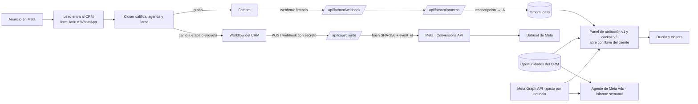

# Arquitectura · cómo viaja un lead de punta a punta

## Las cuatro piezas

| Pieza | Qué hace | Dónde está |
|---|---|---|
| CAPI | Convierte cada escalón del embudo en un evento hacia Meta | `codigo/src/app/api/capi/`, `codigo/src/lib/capi/`, `codigo/src/lib/sales-agent/cliente-capi.ts` |
| Panel v1 | Embudo, gasto, ventas y ROAS por anuncio, con el CRM como verdad | `codigo/src/features/panel-cliente/`, `codigo/src/features/panel-clientes/`, `codigo/src/app/panel/cliente-ejemplo/` |
| Cockpit v2 | Agrega llamadas de Fathom: puntaje, objeciones, ranking de closers, asistente de IA | `codigo/src/features/panel-cliente-v2/`, `codigo/src/features/sales-cockpit/`, `codigo/src/app/api/ai/panel-cliente-v2/` |
| Llamadas | Webhook de Fathom → transcripción → puntaje con IA → tabla `fathom_calls` | `codigo/src/app/api/fathom/`, `codigo/src/features/fathom-scoring/`, `codigo/supabase/migrations/059_fathom_calls.sql` |
| Agente de Meta Ads (cañerías) | Lector de Meta (Graph, solo GET) y cruce con el CRM por anuncio | `codigo/src/features/agente-meta/` (ver `AGENTE-META-ADS.md`) |

## Decisiones de diseño que importan
- **El CRM es la verdad del embudo.** Meta dice cuántos «leads» hubo; el CRM dice cuántos calificaron, agendaron y pagaron. El panel muestra el CRM.
- **El cruce anuncio ↔ oportunidad es por NOMBRE del anuncio** en este cliente (el parámetro UTM de contenido del CRM es igual al nombre del anuncio en Meta; el CRM no guardaba el ID). Si tu CRM guarda el ID del anuncio, cruza por ID: es más robusto.
- **Monedas.** Meta gasta en una moneda y los planes se venden en otra. El panel convierte con una constante (`USD_TO_CLP`). Define la tuya.
- **Todo lo que escribe hacia afuera nace apagado** y se prende con una variable de entorno.
- **Cada cliente tiene su panel y su llave.** La URL lleva `?k=<llave>`; la llave vive en una variable de entorno; sin ella la página responde 404.
